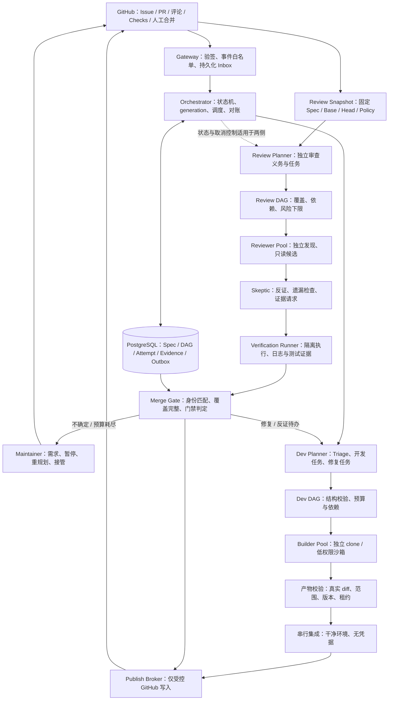
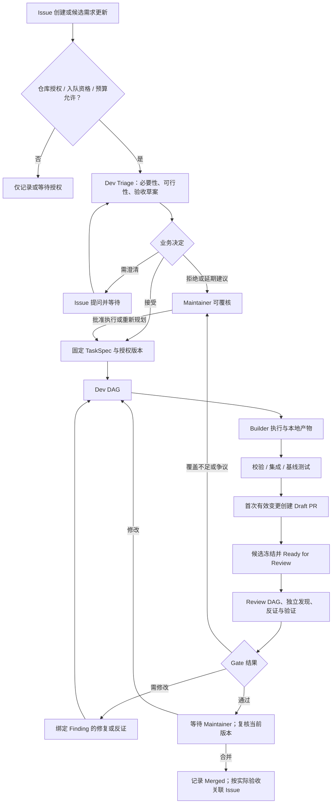
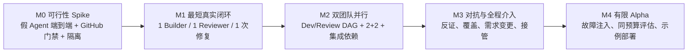

# GitHub-Native 双团队多 Agent 工作流
## 架构审查修订版 v0.4｜目标产品 MVP v0.1

**审查日期：2026-10-12。** 本版替代 v0.3 中对应的架构、协议与路线安排；它是可进入原型验证的设计基线，不是已通过实际系统测试或安全认证的产品说明。

> 产品目标不变：用户在 GitHub Issue 提需求；Dev Team 评估是否执行并完成开发；Review Team 独立审查 PR；Maintainer 可以在任意阶段介入，最终由人决定合并。长期无人值守自治不属于 MVP。

## 0. 审查结论、范围及证据等级

**结论：保留总体架构，修订执行契约后有条件进入实现。** v0.3 不是方向错误，而是部分正确的原则尚未落成可测试语义，并且把关键可靠性工作排得过晚。

本次完整阅读了原 Markdown，检查原架构图，重新核对相关公开规范及产品资料，并通过 GitHub 读取 SWE-AF 的指定架构文件。没有运行这些产品，没有执行性能基准，没有测试一个已经存在的本项目代码库，也没有验证用户仓库的 GitHub 计划及分支规则。不能把“文档中提供了能力”写成“已经验证生产可靠”。

原文件 SHA-256：`53aefdb17fac36b0572871a11c0fca03fd5b6749f52441da916dd3c82c5c34c1`。

证据标记约定：
- **外部事实**：由末尾 S 编号的一手资料支持；链接是本次核对入口，不代表对整个项目的安全背书。
- **设计决策**：本项目拟采用的行为，必须由实现测试证明。
- **待验证项**：尚未完成的 Adapter、GitHub 语义、性能或部署实验。

### 0.1 原设计中继续保留的部分

Issue/PR 作为外部协作入口；Dev/Review 独立规划；普通程序负责调度和权限；结构化产物代替共享全部聊天记录；审查绑定代码版本；Maintainer 人工合并；暂缓知识图谱与规范自动演化。

原文已经提到 Worktree 不等于沙箱、受信任规则、Inbox/Outbox、租约以及 fencing token。本次不是把这些当作“原来完全没有”，而是补充其适用范围、竞态处理、测试义务及实施顺序。

### 0.2 主要审查问题

| ID | 级别 | v0.3 中的不足 | v0.4 修订 |
|---|---|---|---|
| A01 | P1 | 架构借鉴与可直接复用依赖的界限不够明确 | 明确分成模式参考、可选执行器、实际运行依赖；不同时集成多个完整编排器 |
| A02 | P0 | 把部分 fencing、重启对账、权限测试放在最后阶段 | 首个真实 Worker 前完成最小取消、租约、隔离与可靠发布测试 |
| A03 | P0 | `SUCCEEDED` 没有明确等于什么，可能让下游读取尚未集成的成果 | 分离执行结束、产物接受、集成提交；代码依赖仅由已集成产物满足 |
| A04 | P0 | `/ai pause` 的异步取消语义不完整 | 分离停止接纳、停止发布、终止进程和停止确认；增加 generation 与租约双重校验 |
| A05 | P0 | Outbox 容易被理解为消除所有重复副作用 | 明确至少一次处理、效果级幂等及不确定写入对账；不声称端到端 exactly-once |
| A06 | P0 | SHA 字段已经存在，但完整审查身份及失效传播不明确 | 引入 VerificationKey，绑定需求、基线、候选、规则、测试配置及环境 |
| A07 | P0 | 内部 Verdict 与 GitHub Check 的精确映射缺失 | 仅真正通过可发布 `success`；不确定不使用 `neutral/skipped`；内部失效不直接映射为 GitHub `stale` |
| A08 | P0 | Worktree 的共享 Git 元数据、集成器和 Runner 所在信任域没有展开 | Worker 默认独立 clone；集成运算也不持凭据；发布器永不执行仓库脚本 |
| A09 | P0 | “没有发现问题”与“审查完整完成”没有独立门禁 | 增加审查义务清单、覆盖账本、未完成/超时处理和证据类型 |
| A10 | P1 | 任意 Issue 编辑都触发需求版本变化的策略可能造成反复重做 | 区分讨论、变更提议、已接受 TaskSpec；验收条件不能被 Dev 私自降低 |
| A11 | P1 | 接受 Issue 与允许自动花费预算/执行代码不够分离 | 引入 Eligibility Gate 与业务 Triage 两层；首版限制授权仓库和入队方式 |
| A12 | P1 | 工期虽有免责声明，但没有技术 Spike 和阶段数据作为依据 | 取消固定第 1–11 周承诺式呈现，采用纵向切片与退出条件 |
| A13 | P1 | 10 个 Issue 能证明冒烟通路，不能证明审查有效 | 分离确定性可靠性测试与同预算对照评估；报告误报、漏报及总成本 |

P0 在此表示“接入真实自动执行之前必须明确的契约或安全条件”，不是已发现线上漏洞。

## 1. 同类实现重新核对后的取舍

| 参考 | 本次可支持的结论 | 本项目借鉴 | 不应推导的结论 |
|---|---|---|---|
| ARTEX 历史备份 | 备份仓库标明基于 v0.3.15，并标注 AGPL-3.0；不代表原作者当前产品 [S01] | 前序已识别的 Planner/Worker/Frontier 协作思想 | 不以备份推断当前官方维护状态；不直接复制红队模型、提示词与安全策略 |
| Symphony SPEC | 定义 Issue 调度、工作区、退避、协调；明确无需持久化数据库恢复精确内存状态，并不强制统一强沙箱 [S02] | Tracker、Runner、Orchestrator 分层 | 不是自带 PostgreSQL 事务恢复和双团队审查的成品 |
| SWE-AF ARCHITECTURE | 文档描述任务 DAG、验证修复及分级升级；其中架构评审耗尽存在自动批准策略 [S03] | 任务契约、依赖排序、换方案/拆分/升级 | 不移植“预算耗尽即通过”，也不把项目自述当本项目性能结果 |
| agtx | 共享 Blackboard、每任务 Worktree、会话与阶段交接 [S04] | 任务产物共享、独立执行工作区 | Worktree 与会话分离不等于操作系统级安全隔离 |
| OpenHands SDK | Agent、Conversation、工具、Workspace 及远程 Agent Server 分层 [S05] | 一个可选 Runner 实现 | 不必同时引入 OpenHands Automation、完整 UI 和另一套调度器 |
| gh-aw | Markdown 工作流、只读/沙箱默认路径、验证后的 safe outputs；官方仍明确风险与人工监督 [S06] | 模型输出与有权限写入分开 | 引入它不自动证明整个系统安全；首版也不必依赖它运行 |
| ng/adversarial-review | Optimizer/Skeptic、证据审查；默认自动修复，可 `--no-fix` [S07] | 独立找问题，再质疑与验证 | 不把该插件默认自动修复直接放进只读 Review Team；模型共识不等于事实证明 |
| CodeRabbit 路径规则 | 可按路径定义审查关注点 [S08] | 受信任 ReviewProfile 的组织方式 | 商业产品的公开功能不等于可嵌入我们的内部 SDK |
| Temporal | Workflow Execution 与应用活动分离的持久化执行模型 [S09] | 后续复杂调度时的候选 | PostgreSQL 自研一定更便宜、更简单或足以替代全部可靠性能力 |

**依赖决策：** 第一版自研一个有界的协作控制层，只接入一个已验证的 Agent Runner。其他项目提供模式参考，而不是把多个 Orchestrator 堆叠。未来确实需要多服务协调、复杂补偿和长期大量等待时，再通过专门 ADR 比较 Temporal 与继续维护自研状态机。

**许可决策：** 建立依赖清单，记录仓库、版本、许可证和实际复用文件。ARTEX 的许可标记应进入核查项；“参考思想”和“复制或修改代码”分开记录。具体发布方式的许可适配另行核查，不能从“开源”直接推断没有集成约束。

## 2. 产品范围与首版默认值

### 2.1 明确支持

首版只接入一类 GitHub 仓库配置和一种可稳定测试的技术栈；用户通过 Issue 交互，不另造需求入口。每个 Issue 默认对应一个主要 PR，内部可拆多个 Dev Intent 与 Review Intent。两个团队各有逻辑 Planner；成熟 MVP 允许两个 Builder 和两个 Reviewer 并发，但先做 1+1 的纵向切片验证。

每仓库初期最多一个处于主动开发/集成的 Issue；在人工审查时不占 Worker。是否允许此时启动下一个 Issue 由配置决定；允许时必须重新验证后来 PR 相对于最新目标分支的集成状态，不能共享旧通过结论。

Maintainer 可暂停、取消、重规划、要求重审、修改已接受需求并接管代码；默认使用 GitHub 原生合并界面，机器人不自动合并或部署。

### 2.2 暂不支持

任意公网用户自动触发无限计算；未经审核的 Fork 自动执行；一次 Issue 自动修改多个仓库；自动降低验收要求；自治改写规则；不受控安装 MCP/Skills；生产凭据和生产部署；完整代码知识图谱；多个可互相接管的自组织总 Agent。

### 2.3 默认值只是配置，不是能力证明

- 首个真实切片：1 Builder、1 Reviewer；之后扩展到 2+2。
- 每 Intent 两次执行尝试；整个 Issue 最多两轮自动修复；重规划不得重置 Issue 的总预算。
- Reviewer 工具失败、覆盖不完整或证据争议：阻塞/人工处理，不算通过。
- 预算包含 Planner、Worker、Skeptic、模型重试、验证运行及 CI，不能只统计 Builder Token。
- 只有适配器提供可靠用量或服务侧限额时，才能声称有硬费用上限；否则使用请求数、输出上限、墙钟与容器资源边界，并公开成本估计误差。

## 3. 修订后的组件架构



图中逻辑盒子不代表一个微服务或一个常驻模型。首版可部署为 Go 控制进程、PostgreSQL、一个 Runner Supervisor 和短生命周期沙箱；GitHub 写入凭据只在受控进程。模型调用凭据也必须与执行项目脚本的环境分离，或使用可撤销、限额的运行专属凭据。

### 3.1 两队共享基础设施，不共享决策权

| 能力 | 共用内核 | Dev 特化 | Review 特化 |
|---|---|---|---|
| Planner | 事件合并、版本快照、结构化输出、预算 | 必要性/可行性、任务拆解、修复分派 | 风险覆盖、验证任务、争议分派 |
| Worker | 任务领取、日志、取消、产物收集 | 允许修改自己的源码副本 | 候选代码不修改；可在临时副本写测试和构建产物 |
| Blackboard | 持久化、检索、来源记录 | 实现记录、依赖产物 | Findings、反证、覆盖账本 |
| 权限 | Run-scoped 工具白名单 | 不能修改受信任门禁或直接推送 | 不能自行修复 PR 或决定合并 |

Planner 提议 DAG；Orchestrator 校验环、重复、任务数、依赖类型、路径、预算和版本后才接纳。Worker 可以报告新的建议，但不能自行扩展工作范围或启动无限子代理。首版对工作流可见的子任务统一进入同一调度器。

### 3.2 Orchestrator、Integrator 与 Gate 的区别

Orchestrator 管运行状态，不判断需求价值；Dev Planner 提出价值判断，但授权和预算由代码执行。Integrator 默认是确定性的 Git 操作服务，遇到冲突再生成专门 Dev Intent，而不是自动启动一个可任意重写代码的“超级 Agent”。Merge Gate 计算规则是否满足，不声称自己能确定性证明程序正确。

## 4. Issue 驱动的完整业务流程



### 4.1 Triage 不应自动变成执行授权

Eligibility Gate 由普通代码先检查安装范围、仓库 opt-in、自动执行白名单或授权标签、并发和预算。Triage 再判断是否值得做、是否能做、是否需要拆小。新建 Issue 本身不是授权执行任意 shell 命令。

已被授权的仓库可以配置低风险 Issue 自动接受；高风险改动、要求扩大网络权限、迁移或规则变更必须人工审批。风险不能只信 Dev 自报：路径规则与实际 diff 提供下限，Review 可以升级风险，不能私自降低。

### 4.2 需求版本的三层区分

`Discussion` 是原始讨论；`SpecChangeProposal` 是对目标或验收的修改建议；`TaskSpec` 是已接受、可调度的版本。

Issue 修正错字不应自动废弃全部任务。修改行为或验收条件时，暂停相关工作并形成变更提议；经过既定授权或 Maintainer 接受后更新 TaskSpec、generation，并重新计算受影响任务。Dev 和 Review 都不能在预算不足时自行删减必需验收标准。

TaskSpec 保存 Issue/评论来源 ID、内容摘要哈希、验收条目 ID、非目标、风险、约束、批准者/批准策略版本。Review 基于已接受 TaskSpec 验收，同时仍可检查原始讨论是否存在未处理冲突。

### 4.3 Draft PR 与外部参与

首次形成真实变更后再创建 Draft PR；零变更不创建空 PR。开发中只更新机器人拥有的 PR 摘要区和状态评论，不覆盖 Maintainer 的文字。人工推送或 PR Base 变化时对账并暂停冲突性发布，禁止强制覆盖人工修改。

PR 被关闭但未合并，不表示需求已完成；Issue 被关闭，也不表示代码已安全交付。重新打开不能自动重放所有旧操作，应重新检查任务资格、代码与版本。最终通过 GitHub 真实合并事件确认 `MERGED`，不能由 Agent 自报。

## 5. 领域模型与状态机

### 5.1 不把所有含义挤进一个 status

| 对象 | 主要字段/状态 | 说明 |
|---|---|---|
| Workflow | `phase`、`control_mode`、`generation`、`state_version` | 业务阶段与暂停/取消分离 |
| TaskSpec | `revision`、`digest`、`criteria[]`、`authorization` | 不可变的需求版本 |
| Intent | `team`、`kind`、`plan_revision`、`depends_on[]`、预算、范围 | 稳定的工作单元 |
| Attempt | `run_id`、`attempt_id`、`lease_epoch`、`expires_at` | 一次具体执行；不能与 Intent 混用 |
| Artifact | 基础与结果 Commit、实际 diff、内容哈希、来源 Attempt | 是候选产物，不是天然可信事实 |
| IntegrationRecord | 输入 Artifact、集成顺序、生成的 Commit、检查记录 | 下游代码依赖的可用性依据 |
| ReviewRun | VerificationKey、Coverage Ledger、Findings | 一次完整审查快照 |
| GateDecision | 身份、证据、判定、原因、发布时间 | 不可由任意 Worker 写入 |

业务阶段建议为：

`INTAKE → TRIAGE → SPEC_READY → PLANNING → DEVELOPING → VERIFYING → REVIEWING → AWAITING_MAINTAINER → MERGED`

`NEEDS_INFO`、`DEFERRED`、`REJECT_PROPOSED`、`CHANGES_REQUESTED` 为有明确定义的等待/回退分支，不使用一个含多个 `|` 的长箭头字符串充当实现状态机。

控制模式独立为：`ACTIVE / PAUSING / PAUSED / CANCELLING / CANCELLED / HUMAN_OWNED / RECONCILING`。恢复时不盲目设置 `previous_state`，必须重新确认 GitHub 当前对象、Spec、代码版本和有效产物。

### 5.2 Intent 完成与代码可用性

Dev Intent 可用状态：

`QUEUED → LEASED → RUNNING → OUTPUT_READY → VALIDATED → INTEGRATED`

失败分支：`RETRY_WAIT / BLOCKED / EXHAUSTED / CANCELLED / SUPERSEDED`。

Worker 退出码为 0 只能结束 Attempt，不能直接标记 Intent 完成。产物通过结构、路径、版本及必要测试后才能 VALIDATED；集成进入候选提交后才 INTEGRATED。下游需要代码时，只能消费明确的集成提交 SHA。研究/设计类依赖则可以由经验证的非代码 Artifact 满足。

Review Intent 不要求集成，使用 `QUEUED → RUNNING → OUTPUT_READY → ACCEPTED`，其中 ACCEPTED 必须有该任务覆盖结果和证据/未验证说明。

### 5.3 两种版本计数器

`generation` 是整个 Workflow 的执行代际：被接受的需求变更、暂停/接管、关键重规划或候选替换会撤销旧代际的有效写入权限。`lease_epoch` 是单个 Intent 的领取代际：租约过期重新分派时递增。

产物采纳、状态推进及发布请求都必须匹配二者，外加 `state_version` 的 CAS。旧 Worker 可以留下隔离的诊断日志，但不能覆盖新产物、释放新任务依赖或发布 PASS。

租约能保证“至多一个当前有效的结果提交者”，不能保证断网/进程失联时机器上从来不会同时有两个执行副本。因此孤儿进程也必须运行在独立沙箱，输出可拒绝、凭据可撤销。

## 6. Git 并行与产物集成

Git Worktree 会共享部分 refs 和默认仓库配置；将可写公共 `.git` 挂载给所有容器，会破坏“独立工作区”期望的边界。[S10]

**首版默认使用每 Attempt 独立 clone 或源码快照加独立 Git 元数据。** Worktree 可以保留为经过测试后的优化，但不把共享可写 Git 元数据交给不受信任 Worker。镜像缓存可只读复用；不得通过可写共享缓存跨团队污染状态。本地 clone 也不能因可写硬链接或共享 objects 目录重新引入跨 Attempt 修改通道；创建方式必须在隔离测试中验证。

具体集成契约：

1. Workspace Manager 根据确定 SHA 建立工作区，取消默认 Git hooks 和不受信任全局配置影响，不向工作区写入仓库令牌。
2. Builder 只能输出 patch/commit bundle 与任务报告；宿主侧 Supervisor 独立采集实际变更，校验新增、删除、重命名、权限位、符号链接、子模块和超出允许范围的路径。
3. 预计文件清单用于调度冲突预测；实际 diff 是验收依据。路径范围只是产物约束，不是 Bash 的文件系统安全边界，二者需要分别实现。
4. 相同关键文件或接口的任务首版顺序执行；无冲突任务并行。已知代码依赖要从集成后的 SHA 启动，不能仅向下游发送一句“上游已完成”。
5. Integrator 在无凭据环境串行应用 patch，记录原始 Artifact → 集成 Commit 的映射，并重跑检查。出现语义/文本冲突就创建修复 Intent，不静默采用某一侧。
6. Publish Broker 在干净 Git 环境中按预期远端 HEAD 发布；发现外部提交则拒绝继续覆盖并对账。不能信任 Builder 自己提供的 remote、hook、命令行或 `.git/config`。

Review 使用固定候选快照。需要构建或编写测试时在可丢弃副本中执行；原始候选哈希保持不变，测试文件单独记录。只读候选不等于禁止所有临时写入。

## 7. 审查团队、证据与对抗协议

### 7.1 必须有独立的审查义务

Review Planner 根据 TaskSpec、真实 diff、受信任策略及代码上下文提出审查计划。最低义务由 Policy 定义，避免 Planner 自己遗漏一项之后又宣称“计划全部完成”。至少覆盖必需验收条目、受影响接口、测试变更和风险路径。

覆盖账本示例：

| obligation_id | 目标 | 结果 | 证据 |
|---|---|---|---|
| AC-01 | 合法请求按协议返回 | satisfied / failed / unverified | 独立测试运行 ID |
| SEC-01 | 权限边界未被破坏 | satisfied / failed / unverified | 来源分析或隔离复现 |
| COMP-01 | 既有调用者兼容 | satisfied / failed / unverified | 调用链与回归测试 |
| STYLE-01 | 遵守已批准规范 | satisfied / failed / unverified | lint、规则 ID、代码位置 |

`satisfied` 表示该审查义务按照所要求的方法完成，不表示软件不存在其他未知缺陷。必需义务 `unverified` 不能计为通过。

### 7.2 三轮以内的有界审查机制

第一轮，两个 Reviewer 独立检查不同重点，提交各自发现后再互相可见，降低直接复述彼此意见的风险。第二轮，Skeptic 不仅质疑已报告的问题，也检查“认为没有问题”的结论是否遗漏关键验收或攻击面。第三轮仅对仍重要的争议运行独立验证或提交 Maintainer，不无限讨论。

Skeptic 是 Review Team 内的一类任务，不是第三支常驻团队。跨模型是可选的多样性手段，独立权限、独立证据与不同输入才是首版必须实现的边界。不得以“两模型都同意”代替测试或来源证据。

### 7.3 Finding 不是一句修改建议

必须包含：稳定 ID、VerificationKey、类别、严重性、源代码位置或相关接口、风险假设、触发前提、预期/实际行为、证据类型与引用、当前结论、修复/反证历史。

证据类型至少区分：`MODEL_CLAIM`、`SOURCE_ANALYSIS`、`TOOL_VERIFIED`、`HUMAN_CONFIRMED`。模型自报置信度只能排序，不是概率校准后的可信指标。并非所有安全/架构问题都能写成可执行利用；没有 PoC 不等于误报，但需要清晰的代码路径、威胁前提与人工或静态证据。

Finding 状态建议：`PROPOSED → CONFIRMED / REFUTED / DISPUTED`；修复后先 `FIX_CANDIDATE`，重新验证后才 `RESOLVED`。人工风险接受另记 `WAIVED`，要求原因、授权者、有效范围与有效期。新 SHA 不无条件继承 waiver。工具失败是审查未完成，不是 REFUTED。

格式化交给 formatter/lint；Reviewer 处理无法机械判断的规范。纯偏好和无影响的重构建议默认不阻塞，避免对抗系统演变成“为了找问题而找问题”。

### 7.4 Dev 的反驳权

Dev 可提交 Fix Artifact，也可提交 Rebuttal，引用原 Finding 并附反证。Review 重新验证后确认、撤回或升级。Dev 无权自行将问题设为已解决，Review 无权自行放宽原始验收条件。基础设施故障与代码缺陷分开计数，避免 CI 不稳定消耗所有修复轮次。

## 8. 审查身份、GitHub 门禁与 CI

### 8.1 VerificationKey

审查必须绑定一个完整快照，不只是 PR 编号或 head_sha：

```text
VerificationKey = hash(
  repository_id, pull_request_number,
  task_spec_digest, workflow_generation,
  base_sha, head_sha,
  policy_digest, verification_profile_digest,
  runner_image_digest
)
```

记录测试真正运行的 `tested_commit_sha`、`tested_tree_sha`、CI workflow/run/attempt ID 及产物哈希。当 CI 测的是 test merge commit 时，必须明确它如何对应本轮 base/head，而不是因 `head_sha` 看起来相同就接受。环境变化会影响验证有效性，首版采用保守重跑策略。[S11]

新代码、基线、已接受需求或有效策略变化，旧结果均不能继续支持新 Verdict。MVP 默认整轮重审；增量复用放到后续，否则很容易错误复用旧依赖的证明。

### 8.2 通过条件

```text
PASS = current_identity_matches
    && workflow_is_publishable
    && required_mechanical_checks_passed
    && all_mandatory_review_obligations_completed
    && no_unresolved_blocking_finding
    && no_required_verification_pending
    && accepted_artifacts_have_valid_provenance
```

Policy Engine 只确定性检查这些条件，不把语义正确性变成了数学证明。Agent 文字“全部测试通过”、模型自己写的 JUnit 文件、或哈希相等本身都不是测试成功证据。由隔离 Verification Runner 采集命令、进程退出码、日志与配置来源；对重要行为增加不受 Builder 控制的验收测试。候选代码仍可能识别和规避测试，故这不是绝对安全保证。

### 8.3 GitHub Check 精确映射

GitHub 必需检查可以把 `success`、`skipped`、`neutral` 视为通过；外部应用不能自行把 Check Run conclusion 设置为 `stale`。[S11][S12]

| 内部状态 | 稳定必需检查 `workflow/merge-gate` | 说明 |
|---|---|---|
| 真正 PASS | `completed/success` | 仅此一种正常自动放行结果 |
| 执行中、等待完整验证 | `queued` 或 `in_progress` | 不发送 completed 的伪通过状态 |
| 确认需修复 | `completed/failure` | Finding 明确关联当前快照 |
| 争议、暂停、超时、预算耗尽、无法验证 | `completed/failure`，摘要区分原因 | MVP 用统一阻塞结果；不能用 neutral/skipped 表示“先跳过” |
| 内部 OBSOLETE | 当前门禁撤销为非通过并调度新验证 | 不调用不允许的 GitHub `stale` 写入 |

诊断检查可有多份，但合并门禁只有一个受控逻辑入口。同一候选上的旧 ReviewRun 不能在新的 ReviewRun 开始后把门禁改绿。历史决策保存在数据库及证据中；GitHub 上的当前门禁投影始终由当前 generation 驱动。同 SHA 重审时复用或重建 Check Run、旧结论撤销以及同名检查的选择行为，必须在 M0 的测试仓库真实验证；本设计不把未执行的 API 联调当作已证明。

必需检查指定预期 GitHub App 来源、启用目标分支更新要求和人工审查。不把普通评论 `LGTM`、PR 线程 resolved 或机器人 APPROVE 等同于系统门禁。GitHub 原生分支规则的计划适用性应在项目接入时实测，管理员绕过能力也应明确检查。[S13]

### 8.4 CI 执行和发布凭据

普通构建测试与确定性扫描继续走 CI；重要检查配置固定在受信任版本，候选 PR 不得通过修改测试命令或 workflow 将门禁变空。Agent 运行脚本的沙箱不挂载 GitHub App 私钥、SSH Agent、Docker socket、宿主目录或生产密钥。

使用 Publish Broker 的 GitHub App 安装令牌发布 bot 分支/PR，不默认依赖仓库 `GITHUB_TOKEN` 触发后续全部流程。GitHub 对不同令牌、事件类型及审批路径有特殊规则，应对实际“创建 PR → 触发 CI”链路做集成测试。[S14]

避免特权 `pull_request_target` 或 `workflow_run` 中 checkout 并执行候选仓库代码；从非特权任务接收的 artifact 也当不可信数据处理，而不是在有凭据进程中直接执行。[S15]

### 8.5 诚实描述一致性边界

GitHub 与 PostgreSQL 不共享事务，Webhook 和 Check 更新存在延迟。原生人工合并按钮不能与内部 Spec/Policy 更新实现跨系统瞬时原子判断。因此不能承诺“修改 Issue 的同一瞬间，旧绿色状态绝不可能被点击合并”。

MVP 将 TaskSpec 固定为验收基线；已接受变更先撤销自动发布资格和旧门禁，再进入新轮次；Maintainer 合并时检查当前状态摘要。严格基线更新和最终检查降低竞态，但原生 UI 的外部竞态与管理员绕过仍是信任边界。若未来需要更强约束，再引入人工显式触发的受控合并通路，并单独验证其竞态与 API 条件，而不是现在假称已经解决。

## 9. 事件、幂等、暂停和恢复

### 9.1 入站和出站

Webhook 对原始请求字节验 HMAC，限制大小及事件类型，验证安装与 repository_id，先持久化 Inbox 再返回 2xx；不能在同步接收请求中运行 LLM 或等待全部权限 API 查询。GitHub 要求及时响应，官方建议异步处理；重投可保持同一 delivery ID。[S16][S17]

每条 Inbox 有 `received / processing / retry_wait / processed / dead_letter` 和处理租约。相同 delivery ID 已收到但未处理完成时，不得被误标成永久完成。按业务对象做第二层幂等，不只按消息 ID 去重：两个不同事件也可能指向同一待创建 Workflow。

外部 GitHub 对象的结构变化与机器人来源分开判断。不能“所有 bot 事件一律忽略”，否则本系统推送的提交不会触发重审。仅拒绝机器人评论充当人工命令；PR、push、check 等事实事件仍正常消费。

Outbox 保证“数据库已提交的动作不会遗忘”，不保证“GitHub 接口恰好调用一次”。每个动作有稳定 action_id、目标、预期版本、远端 receipt 和 `unknown` 状态。创建评论/PR 后响应丢失时先查询远端的作者、对象关系和标识，不能直接重试创建。搜索标识只是定位线索，不能被攻击者伪造后充当授权凭证。

GitHub 不会自动重投失败 Webhook；首版就需要重启/周期对账或有界补投机制。[S18]

### 9.2 Maintainer 控制

命令仅从授权者的新建独立评论解析；身份由 GitHub 权限 API 和配置中的允许角色/成员验证，Webhook 签名只证明来源，不证明发言者有权指挥。评论编辑不重复执行旧命令，变更指令要求新评论。普通用户的内容仍可作为需求输入。[S16][S19]

支持：`status`、`pause`、`resume`、`cancel`、`replan`、`review deep`、`takeover`。`accept/reject/defer` 是 Triage 决策指令。高风险需求接受、规则豁免和预算上调使用更严格授权；可以让 Maintainer 配置策略，但不能把自然语言解释当授权。

暂停分四步：

1. 在任务锁/版本事务内切换 PAUSING，提升 generation，阻止新任务和新的代码/通过结论发布。
2. Publish Broker 拒绝尚未开始的旧代际写入；已开始、结果未知的外部调用登记并对账。
3. Runner Supervisor 中止模型请求和容器进程，收集必要诊断；不能依赖 Agent 自觉说“我停了”。
4. 全部本地可控执行停止后才确认 PAUSED。超时或外部调用未知时显示未完成停止，不谎报已无副作用。

对状态/审计评论可定义有限例外，避免暂停后连停止进度也无法报告。已经被 GitHub 接受的推送无法因暂停自动撤销；是否回退必须单独授权。恢复重新读 GitHub 当前状态，创建新代际或新 Attempt，不保证所有 CLI 可原生续接同一会话。

人工接管进入 HUMAN_OWNED：停止自动 Writer，不覆盖人工提交。Maintainer 明确归还后再对账、重新规划和审查。

### 9.3 最低执行环境

独立低权限容器、不挂宿主控制接口、资源和进程上限、受控出站网络、依赖下载白名单、独立测试服务和运行目录。容器不是抵御全部内核攻击的完美隔离；面对不可信外部代码，需要验证是否改用隔离 VM/microVM 等更强边界。MVP 默认不开放任意 Fork 自动执行。

MCP/Skills 首版静态 allowlist、固定版本、运行范围授权，不允许通过 Issue 安装新服务。模型代理令牌是限额、可撤销的执行凭据，不应继承主账号全部权限。私有代码会发送到哪些模型供应商必须在项目配置中明确选择。

## 10. 实现组合与工程结构

**暂定 Go 模块化单体 + PostgreSQL + 一个 Runner Adapter + 独立 Sandbox Supervisor。** 这是控制工程范围的选择，不是 Go 相对 Rust/Python 的性能实验证明。团队更熟悉其他语言时可以替换，只要保留事件与产物协议。

| 模块 | 实施策略 | MVP 验证 |
|---|---|---|
| Gateway/Permissions | 使用 GitHub API，自己实现小型权限与命令层 | HMAC、角色、去重、限流 |
| Orchestrator | PostgreSQL 状态、租约、Inbox/Outbox；不建立通用工作流平台 | 并发 CAS、暂停、丢失响应和重启 |
| Planner | 两种角色共享基础设施，分别持有自己的任务计划 | 不改权限、不越过 Spec、不无限派任务 |
| Agent Runner | 首先 Spike 一个无交互执行器，再决定 CLI 或 OpenHands | 事件、结束原因、取消、隔离、结构化结果 |
| Workspace | 每 Attempt 独立 clone；安全缓存可后加 | refs/config 隔离、无凭据、产物可回收 |
| Integrator | 串行 Git 应用与集成验证；冲突回到 Dev | 下游读正确 SHA，不覆盖人工提交 |
| Review | 两名逻辑 Reviewer + 按需 Skeptic + 验证义务 | 找到缺陷、允许反证、完整才放行 |
| Gate/Publisher | 普通代码、固定策略、独立可信凭据 | 版本不匹配不能绿，失败不会用 neutral |
| Observability | 状态评论 + 私有日志/证据存储 | 运行、原因、费用、人工动作可追踪 |

Runner 的最小接口：`Capabilities`、`Start`、`Events`、`Status`、`Cancel`、`CollectArtifacts`；`Resume` 是可选能力。不支持就从持久化任务契约和产物重新开启 Attempt，明确报告 restart，不伪装成无损续跑。

```text
cmd/control/
internal/
  github/           # 网关、权限、对象读取、受控写入
  orchestration/    # 状态、调度、generation、对账
  planning/         # 双侧计划与结构校验
  execution/        # Runner Adapter、Supervisor、配额
  artifacts/        # 产物收集、校验、不可变存储
  integration/      # Git 集成及冲突反馈
  reviews/          # Coverage、Finding、反证、Verdict
  policies/         # 受信任 Spec/Policy 与 Gate
  persistence/      # PostgreSQL、Inbox/Outbox、租约
  observability/    # 日志、指标、审计
contracts/
fixtures/
```

大型模型日志不要无限塞进主数据库。数据库保存索引与哈希，产物保存到有访问控制的持久化目录或对象存储；定义保留期、备份及删除规则。公开 PR 评论只包含必要诊断，密钥值、个人信息和不应公开的漏洞细节不能自动原样发布。

## 11. 修订路线：先最短闭环，再并行规模

不保留原来的固定第 1–11 周日历。原文已标明粗略估算，但缺少 Runner 与 GitHub 真正联调的数据。以下是阶段顺序与退出条件，完成 Spike 后再基于实际吞吐、修改轮次和故障率估算日历。



| 阶段 | 必须交付 | 退出条件 |
|---|---|---|
| M0 Spike 与最小控制层 | 一个测试仓库；固定 patch 的假 Agent；最小 Inbox/Outbox、任务代际、权限；Runner 原型与沙箱 | GitHub 检查正确阻塞；重复/丢失响应不产生不可控重复；取消可拒绝旧结果；选定一个实际 Runner |
| M1 真实纵向切片 | Issue Triage → 1 Builder → Draft PR → 1 Reviewer → 修复 → 人工合并 | 一条真实需求能跑完，能暂停与重启恢复；尚不宣称多 Worker 完整产品 |
| M2 多 Agent 协作 | 两队独立 DAG、2 Builder、2 Reviewer、依赖产物传递和串行集成 | 无冲突并行、代码依赖正确、同文件冲突可控；上游修订可使下游失效 |
| M3 对抗协议与控制完善 | 覆盖账本、Skeptic、Finding/Rebuttal、人工接管、Spec 修改 | 漏项/超时不 PASS，误报可反驳，强制重审有效，预算不能被重规划重置 |
| M4 试点 Alpha | 故障矩阵、脱敏审计、预算报告、安装说明 | 所有确定性门禁用例通过；真实任务冒烟稳定；提交与基线相同预算的对照报告 |

可靠性不是 M4 才开始；M4 是扩大故障覆盖和运行验证。每个新增异步组件都必须同时加入重复、取消、过期与恢复测试。

### 11.1 第一个实施批次

**PR-1：协议和确定性模拟器。** 状态、Attempt、VerificationKey、Gate 枚举、假 Runner，加入过期结果拒收与必需检查映射单测。

**PR-2：GitHub 纵向接入。** HMAC → Inbox → Workflow → Outbox → 状态评论/固定 patch PR；覆盖“远端已成功但响应丢失”。

**PR-3：隔离执行与单 Runner。** 独立 clone、容器取消、产物校验、私钥不可见与可信发布。通过后才开放真实 Issue 自动开发。

此顺序让第一批提交就证明关键链路，不先花数周构建尚无真实消费者的抽象层。

## 12. 验收矩阵与有效性评估

### 12.1 确定性验收——必须逐项通过

| 测试 | 场景 | 预期 |
|---|---|---|
| T01 | 同一 Webhook 重投 10 次 | 仅一份业务任务；失败处理可继续，不因去重丢失 |
| T02 | opened/edited/synchronize 乱序到达 | 对账到当前快照，不回滚到旧事件状态 |
| T03 | GitHub 创建 PR 成功但响应丢失 | 先查远端认领，不重复创建 |
| T04 | 评论已成功但发送方崩溃 | 稳定 action_id 对账，不刷屏 |
| T05 | 两个进程争抢 Intent | 一个当前有效租约，陈旧产物不能推进 |
| T06 | 暂停时 Builder 仍在运行 | 不接纳新发布；显示 PAUSING 直到停止确认 |
| T07 | 暂停时有 GitHub 写入在途 | 记录已发动作并对账，不声称已经撤销 |
| T08 | 旧 Worker 在重新分派后返回 | 只可归档旧日志，不能覆盖新结果 |
| T09 | 模型退出成功但没有产物 | 不判定 Dev Intent 完成 |
| T10 | 下游依赖上游代码 | 从正确已集成 SHA 运行，不消费未集成报告 |
| T11 | 两个 Worker 变更同一关键文件 | 顺序调度或明确冲突修复，禁止静默覆盖 |
| T12 | Worker 改 `.git/config` 或别的任务 refs | 不影响共享可信仓库或其他 Attempt |
| T13 | Maintainer 人工推送代码 | 停止旧集成并保留人工提交，不 force overwrite |
| T14 | 候选 A 通过后推送 B | B 必须重新检查；A 结果不能给 B 绿灯 |
| T15 | HEAD 不变但 base/spec/policy 改变 | 旧身份不能发布当前 PASS，按版本策略重新验证 |
| T16 | Review 工具超时、无 Findings | BLOCKED/未完成，不是 PASS |
| T17 | 必需义务未分派或未完成 | 覆盖门禁失败 |
| T18 | GitHub neutral/skipped/假同名检查 | 不能作为本系统正常放行；固定来源与门禁语义实测 |
| T19 | 尝试把内部 obsolete 写成 GitHub stale | Adapter 不发非法请求；改用受支持的阻塞状态 |
| T20 | Dev 两轮未解决问题 | 升级人工，不无限自动修复 |
| T21 | 误报存在可验证反证 | 可撤回 Finding，保留论证记录 |
| T22 | Issue/评论中的伪造命令或提示注入 | 不升级权限，执行范围不扩大 |
| T23 | 未授权用户或机器人评论发 pause/accept | 不执行；正常 bot 的 PR 事实事件仍被处理 |
| T24 | Agent 读取私钥/宿主 socket/生产密钥 | 无可访问挂载与凭据 |
| T25 | 重启期间 GitHub 漏送事件 | 有界对账恢复，未完成 Inbox 可重试 |
| T26 | 重规划、多层重试或调用新 Worker | 不重置全局预算或绕开并发上限 |
| T27 | 修改 CI 配置、删测试后自报全绿 | 受信任验证配置与验收覆盖不能被候选替换 |
| T28 | Issue/PR 关闭、重新打开、转 Draft | 正确停止/重新准入，不把未合并当完成 |

这些是待实现的验收要求，本次未执行，不能标为已通过。

### 12.2 AI 审查有效性——需要对照，不能只做演示

至少准备 10 个真实/近真实任务作为端到端冒烟集，另准备有人工判定的缺陷与无缺陷候选集。关键状态门禁用固定假 Agent/夹具做确定性测试；AI 检出能力另测，不把一次幸运回答当验收。

在相同仓库快照、任务、工具与总预算下，对照：单 Builder + 常规 CI；Builder + 单 Reviewer；完整双团队 + 对抗验证。先固定一套模型配置，重复若干次并记录随机性。不要将 10 个任务的全通过外推为生产安全保证。

报告：需求完成率、已知缺陷检出率、误报率、严重漏报数、修复后回归、平均/高分位时延、人工介入次数、每个被接受 Issue 的总成本，以及并行节省时间是否抵消冲突成本。记录拒绝/延期任务的分母，避免只统计最终成功案例。

### 12.3 放行范围

M4 只放行“已授权仓库、小范围需求、人工最终合并”的 Alpha。暂不宣称支持任意仓库、任意模型、恶意多租户或长期无人干预。后续扩大范围必须重新定义威胁模型与测试集。

## 13. 待决事项与后续版本

进入 M0 前需选一个试点仓库和技术栈、一个 Runner、预算方式以及 Maintainer 角色策略。这些属于工程配置，不应阻碍先写假 Agent 协议测试。

仍需验证：特定 Runner 的取消是否终止子进程、模型凭据能否与 shell 隔离、GitHub 计划对规则的支持、test merge commit 检查匹配、同 SHA 重审的门禁更新、应用权限是否可最小化，以及需要何种容器/VM 边界。未验证项不得用“接口预留”代替安全保证。

后续再考虑 Worktree 缓存优化、增量重审、第二个模型/Runner、跨 Issue 并行、Merge Queue、Repository Graph、冷热记忆和规则建议。与当前业务无关的自治组织、自动规范演化与自动部署继续排除在 MVP 外。

## 14. 一手来源与复核入口

来源访问/复核日期统一为 2026-10-12。主分支和在线文档可能继续变化；落地依赖时应固定实际 release/commit，并记录配置与许可证。本表不给没有实际读到的源代码加“已审计”标签。

- **S01 ARTEX 历史备份**：https://github.com/Hinln/ARTEX 。用于身份、历史范围与许可标记；本轮未重新审计整库。
- **S02 Symphony SPEC**：https://raw.githubusercontent.com/openai/symphony/main/SPEC.md 。重点：§1–3、恢复边界、协调状态；文档为 Draft v1。
- **S03 SWE-AF Architecture**：https://github.com/Agent-Field/SWE-AF/blob/main/docs/ARCHITECTURE.md 。本轮通过 GitHub 读取文件 32–115 行，blob SHA `5997e495f4cce13f3e924e1c882a41e5f5d641e9`。这是文件对象 SHA，不是仓库提交 SHA。
- **S04 agtx README**：https://github.com/fynnfluegge/agtx 。用于 Blackboard、Worktree、阶段会话机制。
- **S05 OpenHands SDK Architecture**：https://docs.openhands.dev/sdk/arch/overview 。用于 SDK、Agent Server 与 Workspace 的实际职责边界。
- **S06 GitHub Agentic Workflows README**：https://github.com/github/gh-aw 。用于默认只读/沙箱、safe outputs 和官方风险提示。
- **S07 adversarial-review README**：https://github.com/ng/adversarial-review 。用于 Optimizer/Skeptic、默认 auto-fix 与 `--no-fix`。
- **S08 CodeRabbit Path Instructions**：https://docs.coderabbit.ai/configuration/path-instructions 。仅用于路径级规范配置参考。
- **S09 Temporal Workflow Execution**：https://docs.temporal.io/workflow-execution 。用于可选持久化执行技术的能力边界；未完成与本方案成本比较。
- **S10 Git Worktree**：https://git-scm.com/docs/git-worktree 。重点：REFS、CONFIGURATION FILE、DETAILS。
- **S11 GitHub Required Checks Troubleshooting**：https://docs.github.com/en/pull-requests/how-tos/merge-and-close-pull-requests/troubleshooting-required-status-checks 。用于最新 SHA、test merge、skipped/neutral 及检查触发。
- **S12 GitHub Check Runs API**：https://docs.github.com/en/rest/checks/runs 。用于 status/conclusion、仅 GitHub 可设置 stale 等约束。
- **S13 GitHub Protected Branches**：https://docs.github.com/en/repositories/configuring-branches-and-merges-in-your-repository/managing-protected-branches/about-protected-branches 。用于规则适用、必需来源、strict、人工审批及 bypass。
- **S14 GitHub Workflow Triggering**：https://docs.github.com/en/actions/how-tos/write-workflows/choose-when-workflows-run/trigger-a-workflow 。用于 GITHUB_TOKEN、安装令牌及不同事件的行为；不能套用旧版绝对说法。
- **S15 GitHub Secure Use**：https://docs.github.com/en/actions/reference/security/secure-use 。用于特权触发器、不可信 checkout/artifacts、凭据及固定 action 版本。
- **S16 GitHub Webhook Validation**：https://docs.github.com/en/webhooks/using-webhooks/validating-webhook-deliveries 。用于 HMAC、原始 payload 与常量时间比较。
- **S17 GitHub Webhook Best Practices**：https://docs.github.com/en/webhooks/using-webhooks/best-practices-for-using-webhooks 。用于 10 秒响应、异步处理、delivery ID 与重投。
- **S18 GitHub Failed Deliveries**：https://docs.github.com/en/webhooks/using-webhooks/handling-failed-webhook-deliveries 。明确失败 Webhook 不会自动重投。
- **S19 GitHub Collaborator Permissions**：https://docs.github.com/en/rest/collaborators/collaborators 。用于真实仓库角色/权限查询。

---

**最终决议：** 保留 GitHub 原生入口和双团队架构；收敛为一个控制内核、一个经过实测的执行器；以版本化任务和可核对证据协作；从最短真实闭环开始，把不丢任务、不越权、不错误放行和可接管作为每阶段的退出条件，而不是最后再补的功能。
